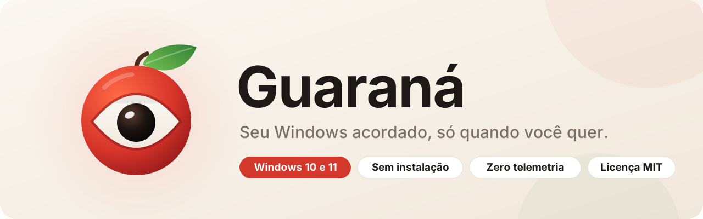
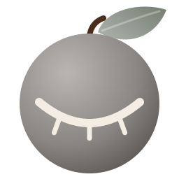
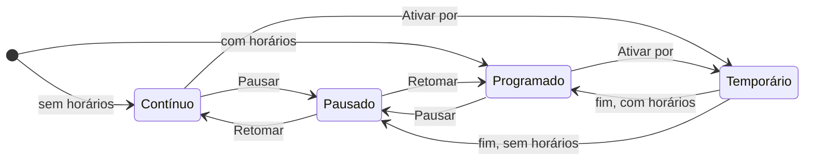

<div align="center">



<br><br>

<a href="https://github.com/VictorJurado18/Guarana/releases/latest/download/Guarana-win-x64.exe"></a>
&nbsp;
<a href="https://github.com/VictorJurado18/Guarana/releases/latest/download/Guarana-win-arm64.exe"></a>

<br>

[](https://github.com/VictorJurado18/Guarana/releases/latest)
[](https://github.com/VictorJurado18/Guarana/actions/workflows/ci.yml)
[](https://github.com/VictorJurado18/Guarana/releases)
[](LICENSE)


<sub>Um único <code>.exe</code> · sem instalador · sem conta · sem rede</sub>

</div>

<br>

O **Guaraná** impede o Windows de suspender, apagar a tela ou te marcar como *Ausente* no Teams e no Slack. Fica quietinho na bandeja e trabalha só quando você quer: o tempo todo, por meia hora ou nos horários da sua semana.

<table>
<tr>
<td width="33%" valign="top">

### ⏱️ Um clique

15 min, 30 min, 1 h, 2 h, 4 h ou 8 h. Quando o tempo acaba, volta sozinho ao normal e te avisa.

</td>
<td width="33%" valign="top">

### 📅 Sua semana

Períodos como *Seg–Sex, 09:00 até 18:00*. Atravessa a meia-noite. Fora do horário, silêncio total.

</td>
<td width="33%" valign="top">

### 🧘 Discreto

Só age quando você está parado. Enquanto você digita ou mexe o mouse, ele não faz nada.

</td>
</tr>
<tr>
<td valign="top">

### 🌙 Tela acesa

Pede ao Windows, pelo caminho oficial, para não suspender nem apagar a tela.

</td>
<td valign="top">

### 🎨 Bonito

Tema claro e escuro seguindo o Windows, cantos arredondados no 11, nítido em telas de alta resolução.

</td>
<td valign="top">

### 🔒 Privado

Zero rede, zero telemetria, zero atualização automática. Tudo fica num JSON no seu PC.

</td>
</tr>
</table>

## Comece em 30 segundos

1. **Baixe** o [`Guarana-win-x64.exe`](https://github.com/VictorJurado18/Guarana/releases/latest/download/Guarana-win-x64.exe) (ou a versão [ARM64](https://github.com/VictorJurado18/Guarana/releases/latest/download/Guarana-win-arm64.exe), para PCs com processador ARM).
2. **Abra.** A janela aparece na primeira vez; depois o Guaraná mora na bandeja, perto do relógio.
3. **Clique no ícone** para abrir a janela. O botão direito abre o menu rápido.

> [!TIP]
> Quer que ele já esteja lá quando ligar o PC? Ative **Iniciar com o Windows** na janela. Não precisa de administrador.

<table>
<tr>
<td align="center" width="50%"><br><b>Olho aberto</b><br><sub>mantendo o PC acordado</sub></td>
<td align="center" width="50%"><br><b>Olho fechado</b><br><sub>pausado ou fora do horário</sub></td>
</tr>
</table>

## Como funciona

O Guaraná combina duas técnicas:

- **Pulso da tecla F15.** Uma tecla que quase nenhum teclado tem e quase nenhum programa usa. Enviada a cada intervalo (59 s por padrão), mantém a sessão ativa para tudo que mede atividade de teclado: Teams, Slack e bloqueio por inatividade. É a ideia que o Caffeine popularizou.
- **Pedido de energia ao Windows.** Enquanto ativo, avisa o sistema que precisa da máquina e da tela ligadas, como um player de vídeo faz.

E alguns cuidados vêm de fábrica:

- Nada de pulso enquanto você segura Shift, Ctrl, Alt ou Win, para não disparar atalhos.
- No modo ocioso (padrão), o pulso só sai depois de um intervalo inteiro sem teclado e mouse.
- Com a sessão bloqueada, nada é enviado.

### Os três modos



| Modo | O que faz |
|---|---|
| **Contínuo** | Sem horários programados, fica ativo até você pausar. |
| **Programado** | Segue os períodos da semana. *Pausar* suspende a programação até você retomar. |
| **Temporário** | Passa na frente dos outros. Sobrevive a um reinício do PC no meio do caminho. |

Nos períodos, o início é incluído e o fim, excluído. Fim igual ou antes do início quer dizer que o período termina no dia seguinte, como *22:00 até 02:00*. Nos campos de horário, digite `9`, `930` ou `9:30`: o Guaraná completa para `09:00` ou `09:30`.

<details>
<summary><b>Iniciar com o Windows: o que acontece por baixo</b></summary>

<br>

Ao ligar a opção, o Guaraná copia o executável para `%LOCALAPPDATA%\Guarana\Guarana.exe`, para o caminho não quebrar se você mover o original, e cria a entrada `Guarana` em `HKCU\Software\Microsoft\Windows\CurrentVersion\Run`. Ao desligar, só a entrada do registro sai. Se você abrir uma versão nova do `.exe`, a cópia é atualizada sozinha.

</details>

<details>
<summary><b>Onde ficam os dados e como desinstalar</b></summary>

<br>

| Caminho | Conteúdo |
|---|---|
| `%LOCALAPPDATA%\Guarana\settings.json` | Preferências e estado (pausa, ativação temporária) |
| `%LOCALAPPDATA%\Guarana\Guarana.exe` | Cópia para a inicialização automática, se ligada |

Para desinstalar: desligue *Iniciar com o Windows*, saia pelo menu da bandeja e apague a pasta `%LOCALAPPDATA%\Guarana`. Pronto, não sobra nada.

</details>

## Perguntas frequentes

<details>
<summary><b>O Windows mostrou “O Windows protegeu o computador”.</b></summary>
<br>
É o SmartScreen, que aparece para executáveis sem assinatura digital. Clique em <i>Mais informações</i> → <i>Executar assim mesmo</i>. O código é aberto, e cada release traz o <code>SHA256SUMS.txt</code> para você conferir o arquivo.
</details>

<details>
<summary><b>Funciona no PC da empresa?</b></summary>
<br>
Na maioria dos casos, sim. Mas políticas de grupo da organização podem prevalecer, e o Guaraná não contorna bloqueio manual (Win + L) nem muda configurações de energia.
</details>

<details>
<summary><b>Algum programa reage à tecla F15?</b></summary>
<br>
É raro, mas pode acontecer em softwares que deixam mapear qualquer tecla. Nesse caso, aumente o intervalo ou mantenha o modo ocioso ligado.
</details>

<details>
<summary><b>Por que “Guaraná”?</b></summary>
<br>
A fruta aberta parece um olho, e guaraná é sinônimo de ficar acordado. O ícone conta a história: olho aberto quando ativo, olho fechado quando descansando.
</details>

## Para desenvolvedores

Requer o [SDK do .NET 10](https://dotnet.microsoft.com/download).

```powershell
dotnet run --project tests/Guarana.Tests.csproj -c Release   # testes (rodam em qualquer sistema)
dotnet publish Guarana.csproj -c Release -r win-x64 -o dist   # gera dist/Guarana.exe
```

No Windows, o `build.cmd` faz os dois e já abre o app.

```
Core/        lógica pura e testável: configurações, agenda, máquina de estados
Windows/     integração com o sistema: bandeja, pulso F15, energia, inicialização
Windows/Ui/  tema, controles desenhados sob medida, editor de horários
tests/       testes do Core, sem dependência de Windows
Assets/      logo em SVG e os ícones gerados a partir dele
```

### Publicar uma nova versão

Releases são automáticas:

1. Num branch, suba `<Version>` no `Guarana.csproj` (ex.: `1.1.0` → `1.2.0`) e escreva a seção `## [1.2.0]` no [`CHANGELOG.md`](CHANGELOG.md).
2. Abra um pull request. O **CI** testa, confere se a versão é nova e anexa os `.exe` ao PR para você experimentar.
3. Faça o merge. O **Release** cria a tag `v1.2.0` e publica os executáveis x64 e ARM64, o `SHA256SUMS.txt` e as notas tiradas do changelog.

PRs que não mudam a versão só testam e empacotam.

## Licença

[MIT](LICENSE): use, modifique e redistribua à vontade, mantendo o aviso de copyright.

<div align="center">
<br>

<br>
<sub>Feito no Brasil, com café… quer dizer, guaraná.</sub>
</div>
